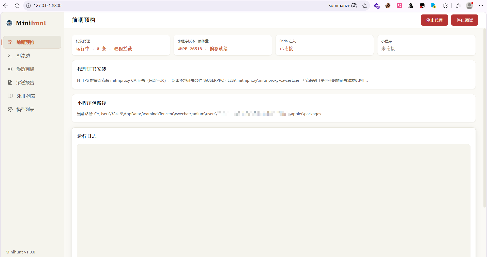
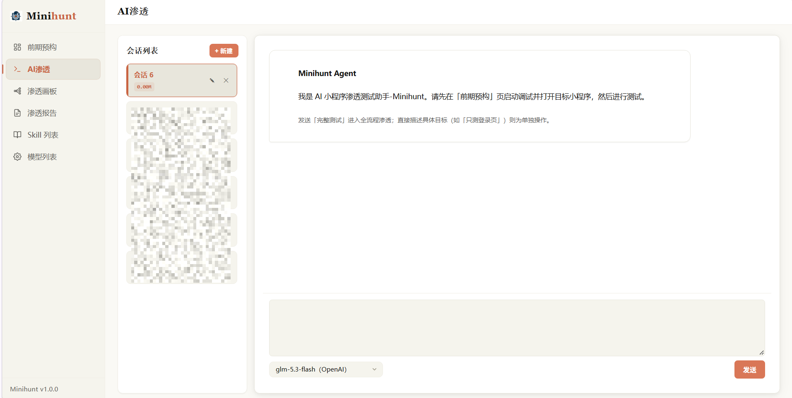
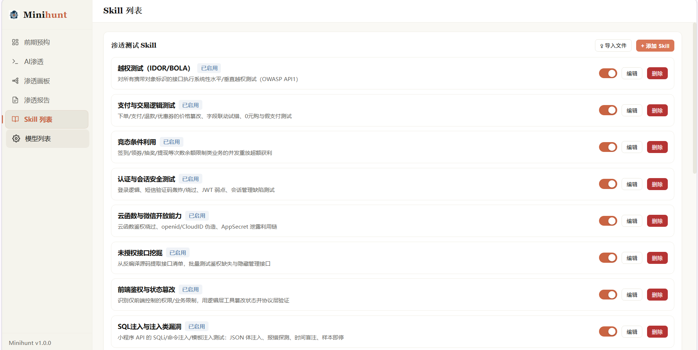

# Minihunt — 微信小程序 AI 自动化渗透测试平台

Minihunt 是一个面向授权安全测试场景的微信小程序渗透测试平台：Frida + CDP 驱动微信 PC 版运行时，像真实用户一样操控小程序，由 AI Agent 按标准渗透流程完成「信息搜集 → 漏洞测试 → 报告产出」全链路。

> 仅限对已获得书面授权的目标小程序进行安全测试使用。

## 免责声明

本项目仅供安全研究与授权渗透测试使用。使用者应确保对所有测试行为拥有合法授权，因滥用本工具产生的任何法律责任由使用者自行承担。

## 核心能力

### 真实操控引擎
- **真实用户级操控**：点击、输入、滚动、跳转一应俱全，直读页面内部数据，挖出界面上看不到的入口
- **全流量抓包**：HTTPS 加密流量完整记录请求与响应，AI 基于真实报文判断
- **反编译分析**：自动解包提取页面与接口清单，727+ 条敏感信息规则扫描泄露
- **微信版本自适应**：自动识别微信版本匹配配置，新版本可用配套工具快速适配

## AI 渗透 Agent

### 上下文管理
- **压缩交接**：水位达阈值自动压缩旧历史为摘要，逐字保留测试关键信息
- **截断保护**：上下文窗口超过水位线自动提醒沉淀笔记、防止压缩截断工具返回
- **Skill 灵活装卸**：漏洞方法论正文不常驻上下文，对应功能点联想加载、测完即卸载
  
### 长任务管理
- **计划驱动**：开工建任务清单，逐项打勾推进，进度以计划表为准
- **卡死检测**：同一操作原地重复自动告警，强制换策略；断连自动熔断恢复
- **覆盖闭环**：计划表、登记册、报告三方对账，漏测项无处藏身

## Web 控制台
主页：引擎状态总览、证书指引、运行日志。

对话页：实时展示 AI 测试过程，随时插话干预。

画板页：功能点与漏洞的思维导图，测试进展一目了然。

Skill页：内置 20+ 类漏洞测试方法论，可编辑、启停、导入自定义 Skill。

