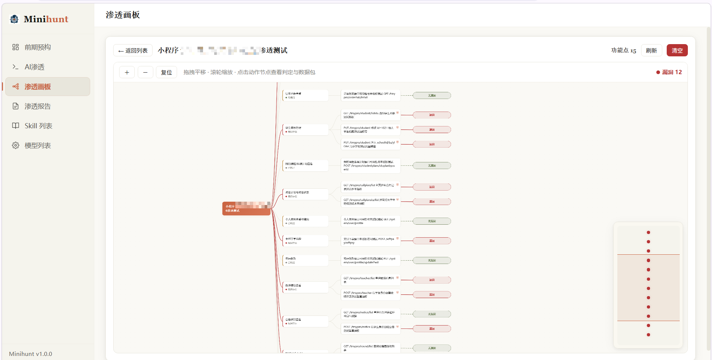

# Minihunt — 微信小程序 AI 自动化渗透测试平台

Minihunt 是一个面向授权安全测试场景的微信小程序渗透测试平台：Frida + CDP 驱动微信 PC 版运行时，像真实用户一样操控小程序，由 AI Agent 按标准渗透流程完成「信息搜集 → 漏洞测试 → 报告产出」全链路。

> 仅限对已获得书面授权的目标小程序进行安全测试使用。

## 免责声明

本项目仅供安全研究与授权渗透测试使用。使用者应确保对所有测试行为拥有合法授权，因滥用本工具产生的任何法律责任由使用者自行承担。

## 核心能力

### 真实操控引擎
- **像真实用户一样操作小程序**：能点击按钮、填写表单、滚动列表、跳转页面，也能直接读取页面内部数据与全局状态——界面上看不到的字段、没渲染出来的入口都能挖出来
- **全流量抓包**：小程序发出的每个请求（包括 HTTPS 加密流量）都完整记录请求与响应，测试人员可以随时翻看真实报文，AI 也基于真实数据做判断，不靠猜
- **微信版本自适应**：自动识别本机微信版本并匹配对应配置，微信升级后可用配套工具快速适配新版本
- **反编译分析**：小程序包自动解包，提取全部页面与接口清单；内置 727+ 条敏感信息扫描规则，AppSecret、云存储凭证、内网地址等泄露一眼可见

### AI 渗透 Agent
- **全流程自动测试**：AI 自动完成信息搜集、功能点发现、漏洞测试、报告生成四步；每发现一个功能点，会按其业务特征自动匹配漏洞类型（越权、支付篡改、竞态、SQL 注入、XSS、文件上传、SSRF 等 20+ 类），加载对应测试方法论逐项验证
- **测试覆盖有底线**：源码里的每个页面和接口都必须测到或说明原因，漏测项会在报告中明确列出，不允许「清单很全但没测完就出报告」
- **证据真实可复现**：报告中的每个漏洞都附带真实抓包数据，复现步骤与数据包一一对应，拒绝 AI 编造报文
- **长时间测试稳定运行**：数小时的全流程测试中 AI 记忆不丢失、任务进度可追踪，中途可随时插入指令调整方向

### Web 控制台
主页提供系统状态总览：代理证书安装指引、小程序包路径确认、Frida 注入状态与运行日志，引擎状态一眼可见。

对话界面实时展示 AI 的测试过程——每一步操作、每一项发现、每条结论都清晰可见，测试中可随时插话调整方向。

思维导图画板将功能点与漏洞的关联关系可视化，测试进展一目了然。

Skill 列表内置 20+ 类漏洞测试方法论（越权、支付逻辑、竞态、认证、SQL 注入等），可启用/停用、编辑与导入自定义 Skill，让 AI 按你的测试策略执行。

